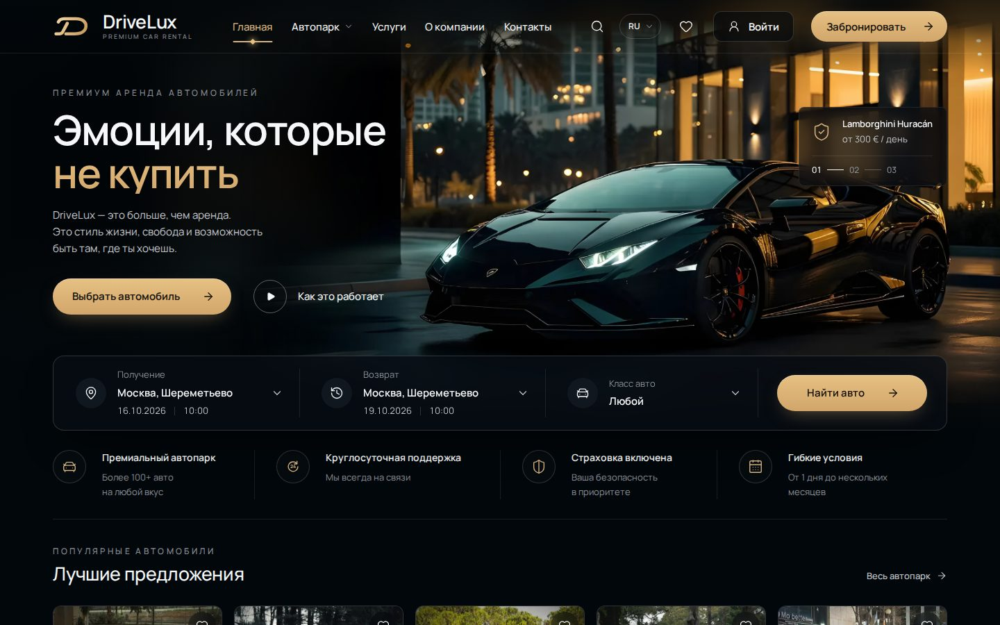
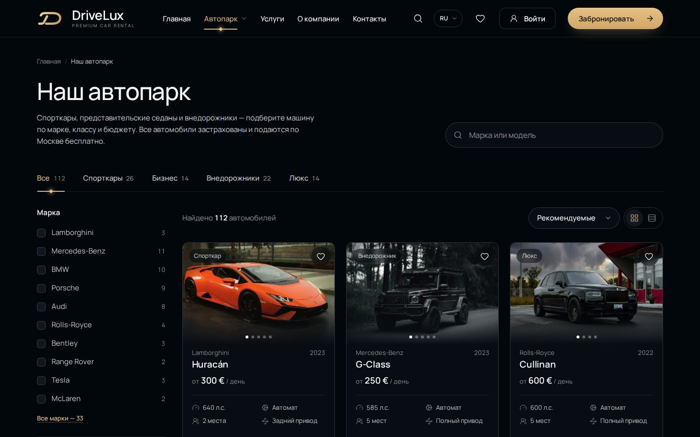
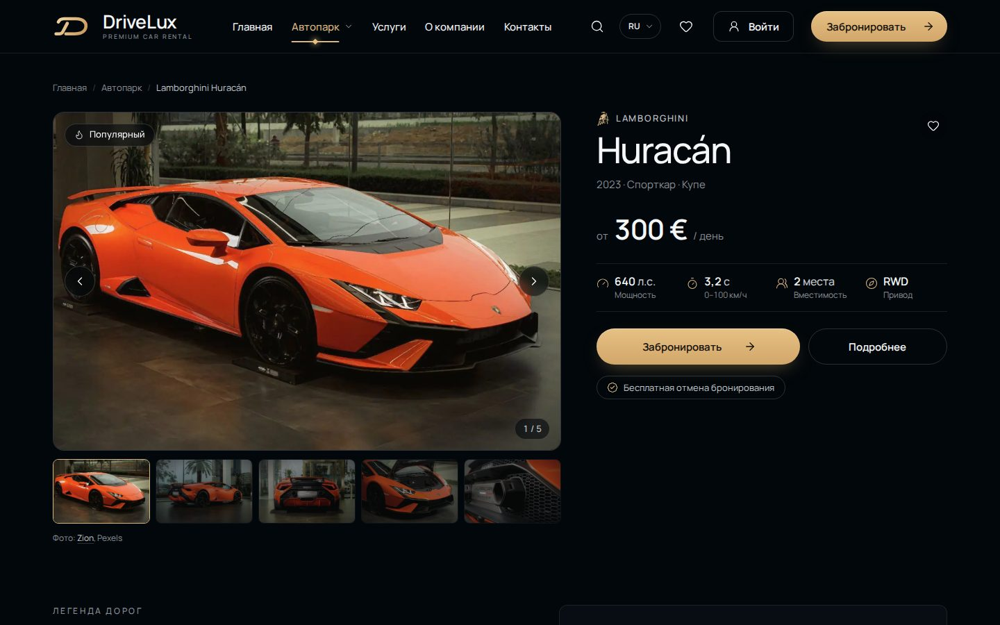
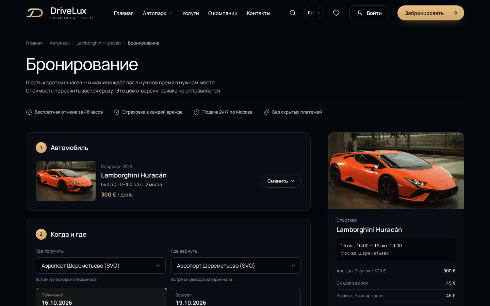
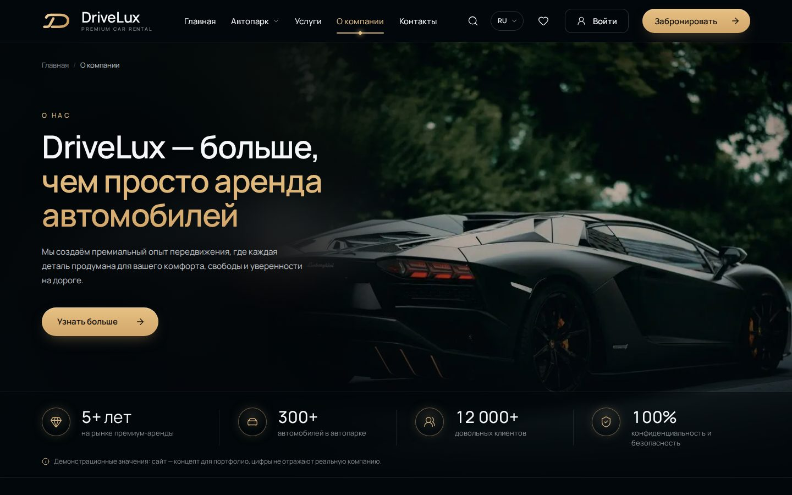
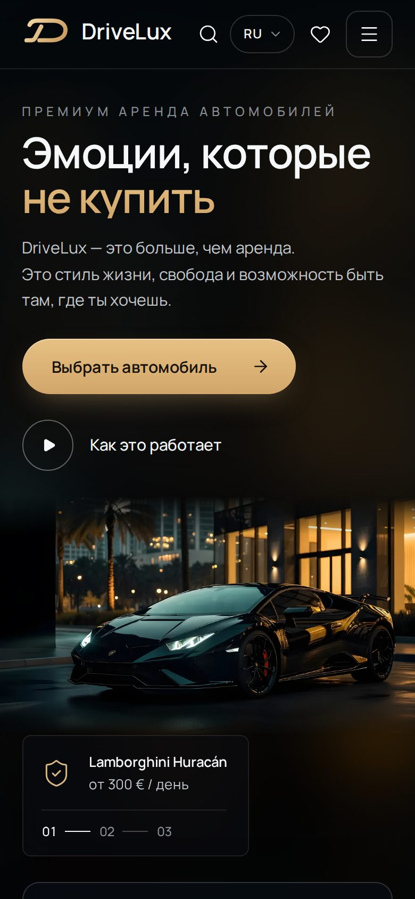
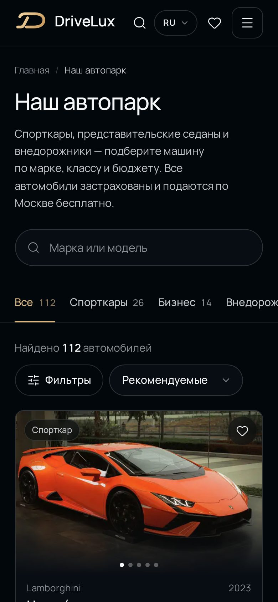

# DriveLux — аренда премиальных автомобилей

Концепт-сайт сервиса аренды премиальных автомобилей в Москве: ночная палитра, золотые акценты, каталог из 112 машин от эконома до Rolls-Royce, сценарий бронирования с расчётом стоимости (демо: заявка никуда не отправляется), программа лояльности, два языка. Проект фронтенд-портфолио — весь сайт работает в браузере, без сервера.

**Демо:** [drivelux-brown.vercel.app](https://drivelux-brown.vercel.app)

[](https://github.com/terartem15-svg/drivelux/actions/workflows/ci.yml)



<p>
  
  
</p>
<p>
  
  
</p>
<p>
  
  
</p>

## Что есть на сайте

| Страница | Что умеет |
| --- | --- |
| **Главная** `/` | Первый экран с панелью поиска (место, даты, время, класс авто — передаются в бронирование), «Лучшие предложения» с галереей, которая листается движением курсора, бренды бегущей строкой, подбор «под настроение», шаги аренды, лояльность, отзывы, FAQ |
| **Автопарк** `/fleet` | Каталог из 112 машин 33 марок: поиск, фильтры по марке, классу, кузову, цене, мощности, коробке, топливу, числу мест и полному приводу; сортировка; плитка или список. Все фильтры живут в адресе страницы — ссылкой на подборку можно поделиться. Фото в карточках листаются курсором |
| **Машина** `/fleet/:id` | Галерея со свайпом, характеристики, салон, условия аренды, опции, похожие машины |
| **Бронирование** `/booking` | Шесть шагов на одной странице: машина, место и даты с календарём, страховой пакет, опции, контакты, оплата с промокодом. Смета справа пересчитывается на каждое изменение: скидка за срок, промокод, подача, итог и залог |
| **Услуги** `/services`, `/services/:slug` | Доставка, экипировка, долгосрочная аренда, корпоративным клиентам, водитель — один шаблон страницы и форма заявки с собственной валидацией |
| **О компании** `/about` | История, цифры, таймлайн, галерея с лайтбоксом, видео |
| **Лояльность** `/loyalty` | Уровни, привилегии, калькулятор: машина, срок и уровень → цена со скидкой |
| **Отзывы** `/reviews` | 30 отзывов с фильтрами по оценке и классу машины и сортировкой (отбор — в адресе страницы); средняя оценка и распределение считаются из данных |
| **Избранное**, **вход**, **регистрация** | Сердечко на любой карточке, счётчик в шапке; аккаунт с именем в шапке |

А ещё: поиск по сайту из шапки, мега-меню «Автопарка», мобильное меню, переключатель RU / EN, страница 404.

## Технические решения

- **React 19 + TypeScript + Vite.** Строгий TypeScript, линтер oxlint.
- **Маршрутизация — React Router (data router).** Каждая внутренняя страница — отдельный файл, который грузится при первом переходе; главная остаётся лёгкой.
- **Двуязычность без библиотек.** Свой модуль `src/i18n/lang.ts`: тексты лежат парами `{ ru, en }`, а функция `localized(ru, en)` требует, чтобы английская версия повторяла все поля русской, — забытый перевод становится ошибкой типов. Язык переключается без перезагрузки и без сброса форм, меняется `<html lang>`.
- **Состояние без Redux.** Избранное, аккаунт, поездка из поиска и язык — маленькие хранилища на `useSyncExternalStore`; избранное, аккаунт и язык сохраняются в `localStorage` и синхронизируются между вкладками.
- **Данные отдельно от вёрстки.** Все тексты, машины и цены — в `src/content/`. Каталог, «Лучшие предложения», меню, поиск, счётчики брендов и классов считаются из одного списка машин. Описания машин вынесены в отдельный модуль страницы машины, чтобы общий файл сайта оставался меньше 500 КБ.
- **Стили — CSS Modules и дизайн-токены** (`src/styles/tokens.css`): цвета, шрифтовая шкала, отступы, радиусы. Без UI-библиотек, вся вёрстка своя.
- **Доступность.** Семантическая разметка, навигация с клавиатуры, видимый фокус, нативные `<dialog>` для окон и меню, подписи для скринридеров, `prefers-reduced-motion` отключает анимации.
- **Изображения.** Все фото в WebP в двух размерах (`srcset`), обработаны под общую ночную палитру; фото галерей грузятся только после наведения на карточку, видео — только по нажатию. Около 1200 фото автопарка лежат в `public/cars/` и подключаются по описи `src/content/carPhotos.ts`, а не через сборщик: так режим разработки не грузит их тысячей отдельных модулей.
- **Адаптивность** от 320 px до широких экранов, проверено на телефоне, планшете и десктопе.

## Запуск

Нужен Node.js 20.19+ или 22.12+ (требование Vite 8).

```bash
npm install
npm run dev       # дев-сервер на http://localhost:5173
npm run build     # проверка типов и сборка в dist/
npm run preview   # просмотр собранной версии
npm run lint      # линтер
```

## Структура

```
src/
├── App.tsx          маршруты
├── components/      общие компоненты: шапка, подвал, карточки, календарь, поиск…
├── sections/        блоки главной страницы
├── pages/           страницы сайта
├── content/         тексты, машины, цены, опись фото — на двух языках
├── store/           избранное, аккаунт, поездка
├── i18n/            языки
├── styles/          токены и глобальные стили
└── utils/           форматирование цен и дат, поиск, хуки
```

## Что здесь демо

Это концепт без бэкенда, и сайт честно об этом говорит:

- заявки на бронирование и услуги никуда не отправляются;
- аккаунты и избранное хранятся только в браузере (`localStorage`), пароль — в виде солёного хеша SHA-256;
- компания, цены, отзывы и цифры на странице «О компании» вымышлены; телефон и почта заведомо несуществующие (+7 495 000-00-00, домен `.example`), адреса у пункта выдачи нет;
- соцсети, мессенджеры, «Вакансии», «Партнёрам», политика конфиденциальности и cookie — неактивные пункты с подсказкой «В демо-версии этой страницы нет».

## Фото

Фото — из Wikimedia Commons, Unsplash и Pexels. Автор каждого фото указан на сайте: в галерее машины и под фото салона, внизу страниц «О компании», «Услуги» и «Программа лояльности»; у фото из Commons — ещё и лицензия. Списки авторов и лицензий — в `src/content/photoCredits.ts`, `photoCreditsFleet.ts`, `interiors.ts`, `about.ts`, `services.ts`, `services.ru.ts` и `loyalty.ts`.

Для сайта фото обработаны: уменьшены, часть кадров обрезана (фото машин в галерее — до 3:2), часть снимков приведена к общей ночной палитре. У фото по лицензиям CC BY и CC BY-SA рядом с лицензией стоит пометка «изменено». Обработанные фото по-прежнему подчиняются условиям лицензии своего исходного снимка (у каждого своя, см. списки выше).

Фото первого экрана подобрано автором проекта вручную. Проект учебный и некоммерческий.

## Лицензия

Код — под лицензией [MIT](LICENSE). Фото, видео и логотипы марок принадлежат их авторам и владельцам и под эту лицензию не подпадают: авторы и лицензии фото — в разделе «Фото» выше.
